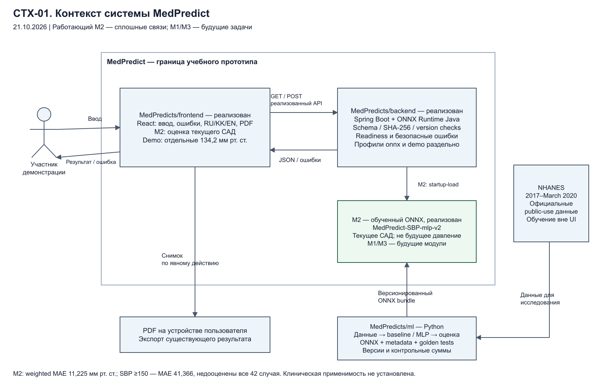

# MedPredict backend

Spring Boot REST API for the MedPredict research prototype. It validates model-specific input, exposes metadata and returns a versioned response. This repository targets Java 17 and uses Spring Boot 3.5.16, Maven Wrapper and springdoc 2.8.13. No database, authentication, request-body logging or prediction persistence is implemented.

[Project documentation](https://github.com/MedPredicts/documentation#readme) · [Jira MED tasks](https://medpredict.atlassian.net/jira/software/projects/MED/boards/2) · [Frontend](https://github.com/MedPredicts/frontend#readme) · [ML research](https://github.com/MedPredicts/ml-ai#readme) · [Architecture sources](docs/architecture/diagrams/README.md)

## Problem, target users and expected results

Medical prediction tasks have different targets, units and observation times. A fixed example, an estimate of current pressure and a future forecast must not be presented as interchangeable results. MedPredict addresses the engineering problem of preserving those definitions from data preparation to the displayed output. This backend provides the checked HTTP boundary: ordered metadata, input validation, explicit provider state and a response carrying its actual version and disclaimer.

The intended audience is students, researchers and participants in supervised demonstrations. Frontend developers and ML integrators use this API to connect the research workflow. Patients are not treated as a validated deployment audience, and the prototype is not a clinical decision service.

Expected backend results are a documented and testable REST contract, independent input/output checks, localized errors, distinct unavailable and fixed-demo states, and reproducible setup/run/test instructions. The wider project also aims to provide model-versus-baseline experiments, a versioned model bundle, a web result flow and PDF export; those outputs belong to the corresponding ML/frontend components and are not all implemented in this backend revision.

## Team, duties and supervisor

| Team member | Responsibilities |
|---|---|
| Sanat Bogenbayev / Санат Бөгенбаев | Frontend, UI/UX, localization, PDF export and browser checks |
| Ali Baimen / Али Баймен | Data preparation, ML experiments, model evaluation, methodology and research documentation |
| Oralkhan Seilkhan Sairanuly / Оралхан Сеилхан | Backend, REST contract, server-side validation and component integration |

The supervisor named by the team is **Турарова Маржан Кабдыкалиевна**. This identifies the supplied supervisor; it does not record her approval or acceptance of the implementation. Role assignments describe responsibility and do not substitute for identifiable contributions or peer review.

## Chosen technologies

The server uses Java 17, Spring Boot 3.5.16, Maven Wrapper, springdoc OpenAPI 2.8.13, Jakarta Bean Validation, Jackson and Lombok. Dependencies and build configuration are recorded in [pom.xml](pom.xml). Components communicate through HTTP/JSON; this published source has no database or ONNX Runtime dependency. The selected technologies support the validation, API-documentation and stateless service boundaries described below.

## Scope for the commission

| Capability | State in this checkout |
|---|---|
| REST metadata and prediction contract, validation, localized errors, CORS and OpenAPI | Implemented |
| Default provider | Unavailable; returns `503 MODEL_UNAVAILABLE` |
| Explicit `demo` profile | Fixed synthetic example: 134.2 mmHg, version `demo-example` |
| ONNX inference and model readiness endpoints | Not implemented in this checkout |
| Accounts, saved predictions, M1/M3 endpoints and module selection | Not implemented |

The application code is based on commit `3588c363e3d34946d86ce75be39a5695a8073176`; later README/diagram commits do not add server capabilities. A separate local backend integration and the ML workspace contain trained M2/ONNX evidence; their presence does not add an ONNX provider to this checkout. Setting an `onnx` profile or a model-directory environment variable alone cannot enable trained inference here.

## Architecture and editable diagrams

The shared diagrams describe the overall project and local M2 integration, including the separate ONNX path and planned application modules. The implementation table above defines what this backend checkout actually provides. Each local preview has a matching editable diagrams.net source; the [diagram index](docs/architecture/diagrams/README.md) records this scope.

| Required diagram | Preview | Editable source |
|---|---|---|
| System context | [PNG](docs/architecture/diagrams/context.png) | [drawio](docs/architecture/diagrams/context.drawio) |
| Use cases | [PNG](docs/architecture/diagrams/use-cases.png) | [drawio](docs/architecture/diagrams/use-cases.drawio) |
| Components | [PNG](docs/architecture/diagrams/components.png) | [drawio](docs/architecture/diagrams/components.drawio) |



## Run

Prerequisites: Git, JDK 17 or newer and network access for the Maven Wrapper to obtain Maven/dependencies. A separate Maven installation is unnecessary. To obtain the published source on macOS/Linux:

```sh
git clone https://github.com/MedPredicts/backend.git
cd backend
```

From the repository root, install/resolve dependencies through the wrapper, run the tests and start the default unavailable provider:

```sh
sh ./mvnw test
sh ./mvnw spring-boot:run
```

On Windows PowerShell, set `JAVA_HOME` to your installed JDK, then use the wrapper:

```powershell
$env:JAVA_HOME = "$env:USERPROFILE\.jdks\ms-17.0.17"
.\mvnw.cmd test
.\mvnw.cmd spring-boot:run
```

The API listens on port 8080 (`PORT` overrides it). With no profile, both prediction endpoints return HTTP 503 `MODEL_UNAVAILABLE`: this checkout has no configured trained-model provider. OpenAPI remains available.

For explicit, synthetic integration testing:

```sh
sh ./mvnw spring-boot:run -Dspring-boot.run.profiles=demo
```

Windows PowerShell equivalent:

```powershell
.\mvnw.cmd spring-boot:run "-Dspring-boot.run.profiles=demo"
```

The demo provider returns the fixed value 134.2 regardless of inputs, with `modelVersion: demo-example` and an explicit DEMO disclaimer. This is not trained inference or a medical calculation. The field schema follows the frontend's provisional example; no unapproved medical ranges are imposed.

Frontend `.env.local`:

```dotenv
VITE_API_MODE=real
VITE_API_BASE_URL=http://localhost:8080
VITE_API_TIMEOUT_MS=15000
```

Here `real` means the frontend uses HTTP. If the server runs the demo profile, its output remains a fixed demo example.

The frontend's standard Vite proxy is another option: keep `VITE_API_BASE_URL` empty and run its API target on `http://127.0.0.1:8080`.

With the explicit demo server running, these requests exercise the contract using synthetic values:

```sh
curl -i http://127.0.0.1:8080/api/v1/model/info
curl -i http://127.0.0.1:8080/api/v1/predictions \
  -H 'Content-Type: application/json' -H 'Accept-Language: en' \
  --data '{"age":52,"sex":"male","bmi":27.4,"totalCholesterol":5.6,"glucose":5.9}'
```

Expected demo result: `predictedValue` 134.2 and `modelVersion` `demo-example`, with an explicit disclaimer. This checks transport and presentation, not model quality. The default unavailable provider returns 503 instead. No backend or browser checks were rerun for this documentation update; `sh ./mvnw test` is the command for verifying the selected source snapshot.

## Contract

- `GET /api/v1/model/info`: ordered field metadata, output unit, precision, and model version.
- `POST /api/v1/predictions`: JSON object with `age`, `sex` (`male`/`female`), `bmi`, `totalCholesterol`, and `glucose` for the demo provider. Numeric strings, nulls, non-finite numbers, invalid categories, and missing required fields are rejected.
- `200`: `predictedValue`, `unit`, `modelVersion`, `disclaimer`.
- `400` field errors: `{"error":"VALIDATION_ERROR","fields":[{"field":"age","message":"Обязательное поле"}]}`.
- Malformed objects, duplicate keys, trailing JSON, or unknown keys: `400` `INVALID_REQUEST`, without echoing submitted values. Unknown field names cannot be returned in `fields` because the frontend rejects those responses.
- Unavailable or invalid inference: `503` `MODEL_UNAVAILABLE`. No automatic fallback.

API responses use `Cache-Control: no-store`. Defaults allow CORS only from `http://localhost:5173` and `http://127.0.0.1:5173`, with no credentials. Override the comma-separated allowlist via `CORS_ALLOWED_ORIGINS`. Configure HTTPS at your deployment boundary. Do not enable request/response-body tracing for medical inputs.

## Connect a trained model

Connecting a trained model requires an implementation change and review, not just an environment setting. Add a `PredictionModel` provider with an explicit profile and mutually exclusive unavailable/demo selection. Its `info()` must describe the exact preprocessing inputs and artifact constraints; its `predict()` must apply the same preprocessing as training and return the version actually used. `PredictionServiceImpl` checks output units and finite values. Keep the demo profile separate. Agree feature schema, artifact, checksum, category encoding, units, preprocessing and numerical parity examples with Ali before enabling real inference.

M2 estimates current systolic blood pressure; it is not a future forecast, diagnosis, treatment recommendation or replacement for measurement. The separate experimental M2 model has substantial high-SBP errors and no Kazakhstan clinical validation. A successful API response or numerical parity check does not establish clinical suitability.

## Structure and conventions

- `prediction/controller/`: HTTP endpoints delegating to the service interface.
- `prediction/service/` and `prediction/service/impl/`: service contract and stateless implementation.
- `prediction/model/dto/`: standalone classes for model metadata, fields, options, and predictions.

Response DTO names describe their role: `PredictionModelInfoResponse`, `PredictionFieldResponse`, `PredictionFieldOptionResponse`, and `PredictionResultResponse`. Shared error DTOs are `ApiErrorResponse`, `ApiValidationErrorResponse`, and `FieldValidationErrorResponse`. POST input binds to `PredictionCreateRequest` while retaining the flat JSON object. `@Valid` runs `@ValidPredictionInput` against active model metadata before the controller delegates to the service. Field violations retain their original names in the 400 response; unknown keys remain INVALID_REQUEST and unavailable models remain 503. Service-boundary checks also protect non-HTTP callers.
- `prediction/infrastructure/model/` and its `impl/` package: inference contract and profile-specific providers. `prediction/model/` is reserved for DTOs and future entities.
- `prediction/validation/`: model-specific input checks.
- `core/configuration/`: type-safe CORS properties, web configuration, and API cache policy.
- `core/exception/`, `core/exception/dto/`, `core/exception/handler/`: exceptions, error responses, and global HTTP exception mapping.
- `MedPredictApplication`: application entry point.

This follows the feature-based structure of `restaurant-service`, with service interfaces and implementations and shared infrastructure under `core`. Tests mirror the corresponding production packages. Persistence entities, repositories, and entity mappers can be introduced when there is a persistence requirement; this backend currently has none.

`SKILL.md` contains reusable Spring Boot conventions for this and other backend projects. This README records MedPredict-specific behavior. Constructor injection and immutable dependencies are used throughout. Request validation uses a schema-driven Bean Validation constraint rather than hardcoded demo properties: real models may require different fields. API DTOs are immutable classes using Lombok for getters, equality, and ordinary constructors. Collection constructors retain defensive copying; DTOs do not generate payload-bearing toString methods. spring-boot-starter-validation supplies Jakarta constraints; the service validates model metadata and prediction responses, including nested DTOs. Database transactions and authentication remain outside the current scope. `SKILL (1).md` concerns the Copilot SDK and does not apply to this service.

M1/M2/M3 selection and time-series requests are not part of this initial frontend contract. No authentication or history endpoints are added.

Contract reference: [frontend API contract](https://github.com/MedPredicts/frontend/blob/main/docs/api-contract.md). Use the controllers and generated OpenAPI in this checkout to determine its actual supported fields and endpoints.


## Localized errors

Send `Accept-Language: ru`, `en`, or `kk` to translate API error messages. Regional variants such as `en-US` resolve to their supported language. Missing or unsupported languages use `application.default-locale`, configured through `DEFAULT_LOCALE` (default `ru`). Machine-readable codes, field names, and JSON shapes stay unchanged.

`core.i18n.MessageService` delegates to Spring MessageSource; `core.model.AppSettings` selects the request language or default. Translations live in UTF-8 `messages*.properties`; the base bundle enables Spring Boot message-source auto-configuration. Missing keys fall back to the key. Validators produce message codes; the global exception handler translates them. Add each new error key to all supported bundles. This change localizes application-owned error responses; model metadata labels and successful prediction disclaimers remain provider-owned.

## Service errors

`core.exception.ServiceValidationException` carries a `core.util.ErrorCode`, a message key, and optional formatting arguments. `GlobalExceptionHandler` translates the message and uses the enum's HTTP status. `INVALID_REQUEST` and `VALIDATION_ERROR` map to 400; `MODEL_UNAVAILABLE` maps to 503. Specific request/model exceptions extend the shared base, so existing callers retain meaningful types. Field-validation exceptions also extend the shared base with VALIDATION_ERROR and a localizable message key, while retaining their dedicated list response. Formatting arguments are copied defensively; never pass sensitive input as message arguments.

Unexpected failures return a localized SYSTEM_ERROR with HTTP 500, without exception details. Spring MVC failures keep their HTTP status and headers with the localized error envelope. Provider failures wrapped by Bean Validation retain their application error code and translation. Model metadata is validated for unique safe keys, units, finite bounds, and valid options before request validation or inference. Startup configuration failures remain developer-facing rather than API service exceptions.

## Swagger / OpenAPI

With the server running, open [Swagger UI](http://localhost:8080/swagger-ui/index.html) or [OpenAPI JSON](http://localhost:8080/v3/api-docs). The UI is also reachable through `/swagger-ui.html`. Documentation works with the default unavailable provider; prediction requests still return 503 until a real model is connected or the demo profile is explicitly enabled.

The API document includes model metadata and response DTOs, a flat dynamic `PredictionCreateRequest`, the `Accept-Language` header, localized validation examples, and 400/415/503/500 error responses. Demo inputs and outputs are labeled as fixed examples. Fetch model metadata for actual field requirements. Set `API_DOCS_ENABLED=false` and `SWAGGER_UI_ENABLED=false` to disable the specification and UI respectively.

Uses the same springdoc Web MVC UI starter version as restaurant-service (2.8.13), compatible with Spring Boot 3.5 per the [springdoc compatibility matrix](https://springdoc.org/v2/#what-is-the-compatibility-matrix-of-springdoc-openapi-with-spring-boot).
